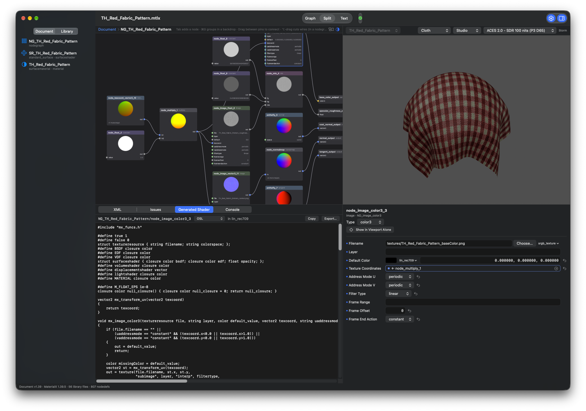
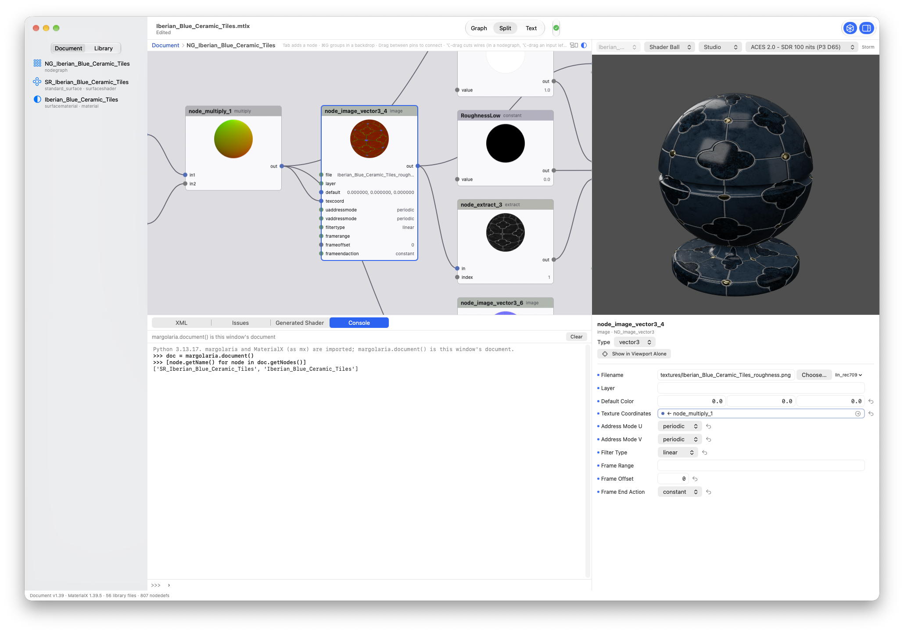

# Margolaria

Margolaria is a [MaterialX](https://materialx.org/index.html) authoring tool for macOS, built with technical artists in mind. It is also an experiment in AI-driven software development and an excuse to learn [Swift](https://www.swift.org).

The application runs on Apple silicon only due to SwiftUsd's macOS frameworks having no Intel code.

## Features

* Full MaterialX authoring workflow.
* Keyboard shortcuts for all common operations.
* Material visualisation using [Storm](https://openusd.org/release/api/_page__material_x__in__hydra__u_s_d.html#MaterialX_In_Storm).
* Material definition validation.
* Can export USD as well as different shader formats: Metal, GLSL, and OSL.
* User defined materials and material libraries.
* Embedded python scripting.

## Interface

* The left pane contains the Document and Library elements. 
* The canvas allows the usesr to interact with the material node graph.
* The viewport shows a Storm rendering of the material with different options for lighting, geometry, and tone mapping.
* The bottom left pane contains the XML editor, the issues report, the generated shader code, and the interactive Python console.
* The bottom right pane shows the node parameters, if a node is selected.




## Development process

Margolaria was born out of my curiosity and willingness to learn more about Swift and MaterialX. The work that lead to 1.0 was spread over the course of 2 months, mainly when I had free time.

After defining the scope for the first version I created a plan with Claude and broke into milestones, each of which was implemented in small steps. The reason for this is that I manually reviewed every line of code that Claude generated to learn more about how Swift applications are made and also to ensure that I had, at all times, a full understanding of the internals. 

Every PR was reviewed as I would do for any production code and only merged when I had a no questions about the implementation and the tests and UX checks were green.

The code is overcommented on purpose so that any person who is not familiar with the language or the macOS frameworks and libraries used can gain an understanding of why and how those specific options where chosen.

## Building

Requires Xcode 27, [XcodeGen](https://github.com/yonaskolb/XcodeGen), CMake and Ninja, and for OSL its dependencies (`brew install xcodegen cmake ninja llvm openimageio imath pugixml bison flex`).

```sh
scripts/fetch-swiftusd.sh     # once: clones apple/SwiftUsd into Vendor/ (about 1.4 GB) and patches it
scripts/build-ocio.sh         # once: builds OpenColorIO as an xcframework in Vendor/ (about a minute)
scripts/build-osl.sh          # once: builds OSL's oslc, testshade and testrender in Vendor/ (several minutes)
scripts/build-materialx-genosl.sh  # once, after the two above: MaterialX's OSL generators as an xcframework (a minute or two)
scripts/fetch-python.sh       # once: Python 3.13 as an xcframework in Vendor/ (a 29 MB download)
scripts/build-pymaterialx.sh  # once, after the one above: MaterialX's Python bindings (about 15 seconds)
scripts/fetch-materialx-examples.sh  # once: MaterialX's example materials (52 MB), for tests and trying the app
xcodegen                      # generates Margolaria.xcodeproj from project.yml
open Margolaria.xcodeproj
```

To sign with your own certificate, copy `Config/Signing.local.xcconfig.example` to `Config/Signing.local.xcconfig` and fill it in.

From the command line:

```sh
xcodebuild -scheme Margolaria -skipMacroValidation -derivedDataPath build/DerivedData build
xcodebuild -scheme Margolaria -skipMacroValidation -derivedDataPath build/DerivedData test
```

### Releases

`scripts/release.sh` archives Margolaria, exports it signed with Developer ID, has Apple notarize it, staples the ticket and checks it with Gatekeeper. The release script creates two artefacts: `build/release/Margolaria-<version>.zip` and `build/release/Margolaria-<version>.dmg`. It needs a Developer ID certificate in your keychain and, once, a notarization profile. `scripts/release.sh --no-notarize` stops after signing.
