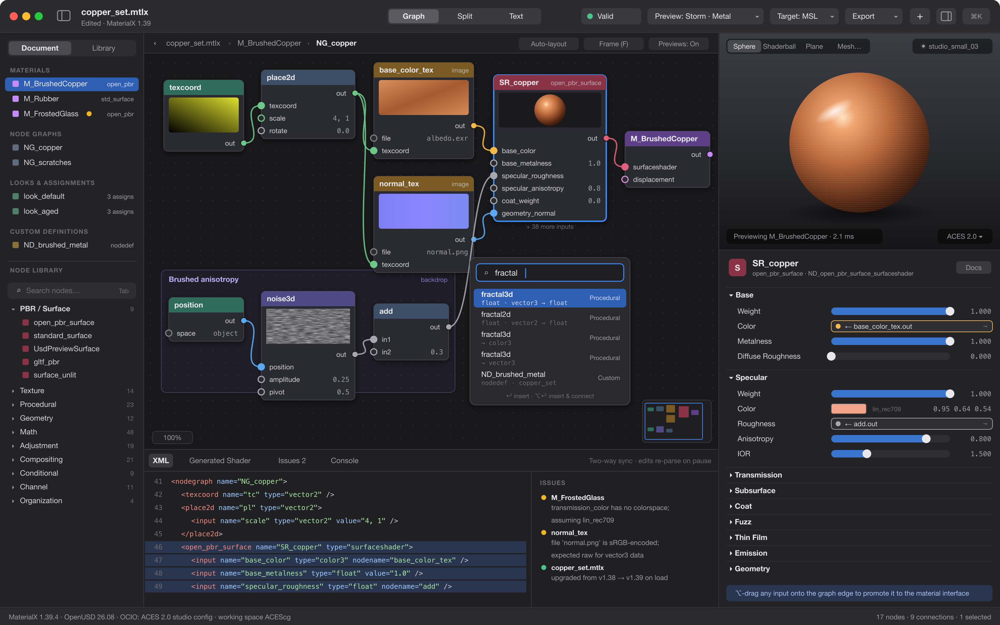

# Margolaria — Plan

*Margolaria* is Basque for "painter". It is a native macOS tool for authoring MaterialX materials.

Status: planning (session 1, 2026-10-11). No code yet.



---

## 1. Goals

- Author, edit and validate MaterialX documents (`.mtlx`) in a node graph, with a live, accurate preview.
- Feel like a real Mac app: SwiftUI/AppKit, Metal rendering, document-based, undo, Quick Look later.
- Don't reinvent the wheel. MaterialX, OpenUSD, OpenColorIO and OpenImageIO are used through their existing C/C++ libraries (via Swift–C++ interop) or through Apple frameworks where they already exist.
- Round-trip safely. Opening and saving a document must not lose attributes, comments-as-data, `colorspace`, `channels`, custom nodedefs or unknown elements.

**Non-goals (for now):** texture painting, mesh editing, a full scene/layout tool, Windows/Linux.

## 2. What exists today (research summary)

| Tool | Kind | What it does well | Gaps / lessons |
|---|---|---|---|
| **MaterialX Graph Editor** (ASWF, ships with MaterialX) | Reference app, ImGui + imgui-node-editor | Loads and saves `.mtlx`; Tab-to-add with search; dives into nodegraphs (double-click, `U` to exit); type-coloured pins; background "group" nodes; property panel; shader-ball render view | Dev-tool UX. Can't create new `channels` connections or assign `colorspace`. No per-node previews. Not native. |
| **QuiltiX** (Prism Pipeline, Python/Qt, Apache-2.0) | Standalone editor | Node graph plus a **Hydra viewport**, so any Hydra delegate (Storm, Arnold, Karma) can preview; plugin hooks; custom nodedefs | Python/Qt; generic look. Its Hydra-based viewport is the approach to copy. |
| **Autodesk LookdevX** (Maya, and inside USD workflows) | DCC-embedded | **Per-node swatches** that update in real time; compounds; promote/demote attributes to the graph interface with a right-click; the Tab menu shows the source library; color-managed colour pickers; keeps a link to the `.mtlx` on disk so edits save back | Lives inside Maya. The best reference for UX polish. |
| **Houdini Solaris / Karma Material Builder** | DCC-embedded (VOPs) | MaterialX VOPs that translate to UsdShade automatically; promoted parameters organised into folders | Houdini-specific concepts (subnets, VOP contexts). Folders for promoted parameters are a good idea. |
| **Reality Composer Pro: Shader Graph** (Apple) | Native macOS | Native look; authors MaterialX inside USD; RealityKit-specific nodes; graph sits in a bottom editor pane with an Inspector on the right | **No per-node previews** (a known complaint). Tied to RealityKit. Closest to "native Mac" in feel. |
| **Substance 3D Designer** (Adobe) | Procedural texture authoring | Dockable Explorer / Graph / Properties / **2D view** / **3D view** / Library layout; multiple 2D views can each show any node's output | Not MaterialX-native. Its panel layout is the industry convention and users know it. |
| **Connecter** (macOS asset manager) | Asset browser with a MaterialX graph editor | Proves there is demand for MaterialX on the Mac; preview in an asset browser | Editing is a secondary feature. |
| **Blender / Unity Shader Graph** | General node editors | Unity: per-node previews. Blender: node frames, reroutes, Ctrl+Shift-click to preview a node (Node Wrangler add-on) | Not MaterialX-native. These are good interaction references. |

### Takeaways that shape the design

1. **The standard layout works:** library on the left, graph in the centre, viewport and inspector on the right, and a dockable bottom panel. Users of every tool above will feel at home.
2. **Per-node previews are the most-wanted missing feature** (RCP lacks them; LookdevX and Unity have them). MaterialX shader generation can produce a shader for *any* output, so we can render a small swatch per node.
3. **Use Hydra for the main viewport** (as QuiltiX does) so previews match what USD pipelines render. Storm on Metal is the default.
4. **Tab-to-add with fuzzy search** is universal. Make it type-aware: when you drag off a pin, show only compatible nodes.
5. **Promote to interface** (LookdevX, Houdini) is how users build reusable materials and custom nodedefs. Make it a first-class gesture.
6. **The text view matters.** MaterialX is human-readable XML. A live, two-way XML view is an advantage no current tool has.
7. **Validation should be visible**: an issue list plus inline badges on nodes. The reference editor's silent failures are a pain point.

## 3. Technology stack

All of the following was verified on 2026-10-11.

| Concern | Choice | Notes |
|---|---|---|
| Language / UI | Swift 6, SwiftUI app shell, AppKit where needed | `DocumentGroup` with a `ReferenceFileDocument` for `.mtlx` |
| OpenUSD (+ Hydra, Storm, HgiMetal) | **[apple/SwiftUsd](https://github.com/apple/SwiftUsd)** 8.1.0 (OpenUSD **v26.08**, released 2026-08-03) | SwiftPM. Requires Swift–C++ interop and GNU++17. Ships HdStorm, HgiMetal, UsdImaging, OpenSubdiv, OpenEXR, Embree. Apache-2.0. |
| MaterialX | **MaterialX C++ as bundled in SwiftUsd**: Core, Format, GenShader, GenGlsl, **GenMsl**, Render, RenderHw, RenderGlsl xcframeworks | SwiftUsd does **not** include MaterialXRenderMsl, GenOsl or GenMdl. **Spike:** check that the MaterialX headers are reachable from Swift through SwiftUsd, and which MaterialX version it bundles (OpenUSD ≥ 25.05 defaults to 1.39). Fallback: our own xcframework of MaterialX 1.39.4 built at the same version as SwiftUsd's. |
| Shader generation for previews | MaterialX **MslShaderGenerator** + our own small Metal renderer for node swatches | The main viewport uses Hydra/Storm, which already runs MaterialX codegen internally. |
| Color management | **OpenColorIO** (C++), built as an xcframework | Needed for colour pickers, the viewport view transform and texture colour spaces. Not in SwiftUsd. Default config: ACES 2.0 studio. |
| Image I/O | **Apple ImageIO** first (handles EXR, PNG, JPEG, TIFF, HEIC), then **OpenImageIO** (C++) when we need `.tx`, tiled or mip-mapped files, or UDIMs | SwiftUsd's Hio already reads images for Hydra. Note: the Swift package called "OpenImageIO" (1amageek) is an unrelated pure-Swift codec library, **not** OIIO. |
| Graph canvas | Custom view. **Spike:** SwiftUI `Canvas` vs. AppKit `NSView` + Core Animation vs. Metal | Must handle about 500 nodes at 120 fps, plus hit testing, marquee selection and wire routing |
| Text view | AppKit `NSTextView` (TextKit 2) with XML highlighting | Two-way sync with the graph |
| Build | Xcode project plus SwiftPM local packages; xcframeworks for the C++ dependencies | We can use SwiftUsd's own scripts as the template for building OCIO and OIIO |

Also worth watching: [wabiverse/SwiftUSD](https://github.com/wabiverse) is a community fork on top of apple/SwiftUsd, with a "HydraKit" Metal viewport that does picking and selection outlines. It may save work on the viewport. Evaluate it, but don't depend on it yet.

## 4. Interface design

See `docs/mockup/margolaria-mockup.png`. The source is `margolaria-mockup.svg`, regenerated by `generate_mockup.py`.

### 4.1 Window regions

1. **Toolbar.** Document title. View mode: **Graph / Split / Text**. Validation status pill. Preview renderer picker (Storm·Metal, or any installed Hydra delegate). Shader target picker (MSL/GLSL/OSL/MDL/Slang/WGSL, for the shader panel and export). Export menu (`.mtlx`, `.usda`/`.usdz` with UsdShade + MaterialX, baked textures later). Add-node button. Inspector toggle. Command palette (⌘K).
2. **Left sidebar** has two tabs:
   - **Document**: outline of materials, node graphs, looks/assignments and custom nodedefs. Each entry shows its shading model and has an issue badge.
   - **Library**: searchable node library grouped like the MaterialX stdlib (PBR, Texture, Procedural, Geometry, Math, Adjustment, Compositing, Conditional, Channel, Organization), followed by project and user nodedefs. Drag nodes onto the canvas.
3. **Graph canvas** (centre):
   - A breadcrumb bar for nested nodegraphs, plus Auto-layout, Frame and Previews toggles.
   - Nodes have a coloured header by category and a **live thumbnail**. Pins are coloured by MaterialX type (float, color3, vector2/3/4, surfaceshader, material, filename/string…). Unconnected inputs show their value inline. Uncommon inputs are collapsed into a "+N more inputs" row.
   - Backdrops (comment frames) for grouping, minimap, zoom indicator.
   - **Tab / drag-off-pin popup**: fuzzy search that shows type signatures and the source library. ⌥↩ inserts the node and connects it.
4. **Viewport** (top right): Hydra/Storm on Metal. Geometry: Sphere / Shaderball / Plane / custom mesh. Environment (HDRI) picker. OCIO view transform. Render time. Click any node to "solo" it (a temporary preview of that node's output).
5. **Inspector** (right): the selected node's name, category and nodedef, with a Docs link. Inputs are grouped by the nodedef's `uifolder` (for OpenPBR: Base, Specular, Transmission, Subsurface, Coat, Fuzz, Thin Film, Emission, Geometry). Widgets are chosen by type and `uimin`/`uimax`/`enum`: sliders, colour wells with colour-space labels, enum menus, file pickers. Connected inputs show their source and can be clicked to jump to it. ⌥-drag an input to promote it to the material or nodegraph interface.
6. **Bottom panel** (collapsible tabs):
   - **XML**: two-way synced text, with the selected node highlighted.
   - **Generated Shader**: source for the chosen target.
   - **Issues**: output of `Document::validate()` plus our own lint checks, for example a colour space on vector data or a missing file.
   - **Console**.
7. **Status bar**: MaterialX and OpenUSD versions, OCIO config, working space, graph statistics.

### 4.2 Key interactions

| Action | Gesture |
|---|---|
| Add node | Tab or right-click on the canvas; or drag off a pin (filtered to compatible types); or drag from the Library |
| Connect / disconnect | Drag pin to pin; ⌥-drag a wire to detach it; drop a node onto a wire to insert it |
| Enter / exit nodegraph | Double-click / `U` or breadcrumb (matches the MaterialX Graph Editor) |
| Frame selection / all | `F` / `A` |
| Solo-preview a node | ⌥-click the node's thumbnail (Blender's Ctrl+Shift-click idea) |
| Group | ⌘G puts the selection in a backdrop; ⌥⌘G collapses it into a nodegraph |
| Promote input | ⌥-drag it to the graph edge, or right-click → Promote |
| Command palette | ⌘K (every menu command, plus node search) |
| Undo / redo | ⌘Z / ⇧⌘Z: full history, including value scrubs coalesced into one step |

### 4.3 Visual language

- Follow macOS dark and light appearance. Use SF Pro for text and SF Mono for values and code. The mockup is drawn in dark mode.
- MaterialX type colours are consistent everywhere: pins, wires, inspector link chips and the XML view.
- Category colours appear only in node headers, and they are muted, so selection (accent blue) and errors (red) stand out.

## 5. Architecture sketch

```
Margolaria.app (SwiftUI)
 ├─ DocumentModel      Swift wrapper over mx::Document; the single source of truth; all edits are commands (undo)
 ├─ GraphLayout        node positions (stored as MaterialX xpos/ypos attributes, as the Graph Editor does)
 ├─ NodeLibrary        loads stdlib + pbrlib + project/user nodedefs; search index
 ├─ Validation         mx validate() + our own lint rules → Issues
 ├─ PreviewService     per-node swatches: MslShaderGenerator → Metal pipeline cache → offscreen renders
 ├─ Viewport           Hydra (UsdImaging + HdStorm/HgiMetal) of a generated USD stage that references the .mtlx
 ├─ ColorService       OCIO config, colour pickers, view transforms
 └─ UI                 Sidebar · GraphCanvas · Inspector · BottomPanel(XML/Shader/Issues) · Viewport
```

Principles:
- **mx::Document is the model.** We never keep a parallel graph representation that could drift from it. UI state lives in views, and layout lives in `xpos`/`ypos`.
- **All C++ goes through a thin Swift layer** (`MXKit`), so the rest of the app is plain Swift.
- **Previews run off the main thread and can be cancelled.** Compiled pipelines are cached by a hash of the generated shader.

## 6. Roadmap

| Milestone | Scope | Exit criteria |
|---|---|---|
| **M0: Spikes** | (a) Read and write a `.mtlx` from Swift using MaterialX through SwiftUsd. (b) Render a USD stage with a MaterialX material in Storm/Metal inside an `NSView`. (c) Generate MSL for a single node output and render a swatch. (d) Prototype a graph canvas with 500 nodes. | Each spike is a small demo target in the repo, with notes |
| **M1: Viewer** | Open `.mtlx`, read-only graph with auto-layout, viewport, XML tab, Issues tab | Opens every example in MaterialX `resources/Materials/Examples` |
| **M2: Editor** | Add, delete and connect nodes; inspector editing; undo; save with lossless round-trip | Round-trip tests on the MaterialX example corpus pass with a byte-equivalent or semantically equal diff |
| **M3: Previews & colour** | Per-node thumbnails, solo preview, OCIO colour pickers and view transform | Swatches update in under 100 ms after an edit on a typical graph |
| **M4: Authoring power** | Nodegraph creation, promote to interface, custom nodedef authoring, backdrops, two-way XML editing, command palette | Can build a custom nodedef from scratch and use it in another document |
| **M5: Pipeline** | USD/USDZ export, other Hydra delegates, shader export (MSL/GLSL/OSL), image I/O through OIIO | USDZ opens correctly in Reality Composer Pro / Quick Look |

## 7. Open questions

1. Does SwiftUsd expose the MaterialX C++ API to Swift directly, or only link it internally for Hydra? (M0a.) This decides whether we build MaterialX ourselves.
2. Should the canvas be SwiftUI `Canvas` or Metal? It depends on M0d performance.
3. Should RealityKit's custom MaterialX nodes (RealityKit PBR, Unlit, geometry modifiers) be supported as a library or target, for visionOS users?
4. Should we have our own reference path tracer later? The MaterialX roadmap mentions integrating OSL testrender, WGSL and MDL as reference renderers.
5. Document format: plain `.mtlx` only, or also open `.usda`/`.usdz` and edit the MaterialX materials inside them?
6. Licensing of the final app. The repo LICENSE already exists; every dependency above is Apache-2.0 or BSD-3.

## 8. Sources

- MaterialX Graph Editor docs: <https://github.com/AcademySoftwareFoundation/MaterialX/blob/main/documents/DeveloperGuide/GraphEditor.md>
- MaterialX annual review, ASWF TAC, 2026-02-04 (1.39.4: hex-tiling, WGSL, NanoColor, animated materials; Slang codegen; OpenPBR Volume; reference path tracers): <https://tac.aswf.io/meetings/2026-02-04/MaterialX_TAC_Update_2026_Final.pdf>
- apple/SwiftUsd (changelog: 8.1.0 → OpenUSD v26.08): <https://github.com/apple/SwiftUsd>
- MaterialX in Hydra/Storm: <https://openusd.org/release/api/_page__material_x__in__hydra__u_s_d.html>
- QuiltiX: <https://github.com/PrismPipeline/QuiltiX>
- LookdevX for Maya, What's New: <https://help.autodesk.com/cloudhelp/2026/ENU/Maya-WhatsNew/files/GUID-26EA5B09-DA2E-4B71-9EA5-0391E4E5B8E8.htm>
- Houdini Solaris MaterialX: <https://www.sidefx.com/docs/houdini/solaris/materialx.html>
- Reality Composer Pro Graph Editor: <https://developer.apple.com/documentation/realitycomposerpro/realitycomposerpro-essentials-grapheditoroverview>
- RCP node previews forum thread: <https://developer.apple.com/forums/thread/747781>
- Substance 3D Designer interface: <https://experienceleague.adobe.com/en/docs/substance-3d-designer/using/workspace/interface>
- Connecter MaterialX editor: <https://blog.connecterapp.com/inside-connecters-materialx-node-graph-editor-0d7df2a54c6e>
- wabiverse SwiftUSD v26.8.3: <https://github.com/orgs/wabiverse/discussions/44>
