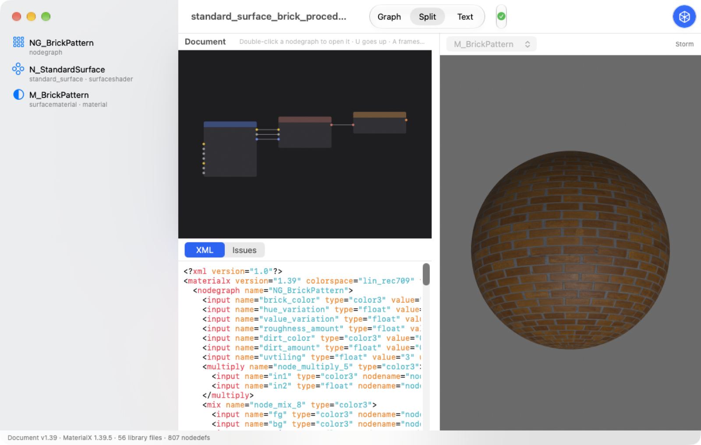

# M1: Viewer

**Goal** (PLAN.md §8): open a `.mtlx` file and show it: a read-only graph with automatic layout, a 3D viewport, the XML, and an issue list. **Exit criterion:** every example in MaterialX's `resources/Materials/Examples` opens.

**Result: met.** All 50 examples in MaterialX 1.39.5:
- open, with `xi:include`s resolved;
- validate with no errors;
- show every level of their graph, with every connection resolved;
- render in Storm: all 84 materials, textures included.

Tests check all of this on every run (`MXCorpusTests`, `GraphBuilderTests`, `StormCorpusTests`) once the examples are fetched with `scripts/fetch-materialx-examples.sh`.

Dates: 2026-10-23 to 2026-10-24. Four PRs: #10 (M1a), #11 (M1b), #12 (M1c), #13 (M1d). About 7,000 lines of Swift, C++ and Objective-C++ in the app and MargolariaKit, and 54 test functions, several of them run once per example file.

## What was built

| PR | Scope | Main pieces |
|---|---|---|
| **M1a** (#10) | Document model and corpus | `MXGraph`/`MXNode`/`MXPort`/`MXConnection` (one graph level as Swift values) · `MXIssue` and `MXLint` · reading from a file URL · `NSDocument` app · `scripts/fetch-materialx-examples.sh` |
| **M1b** (#11) | Read-only graph canvas | `GraphBuilder` (MaterialX → canvas model) · `GraphAutoLayout` · breadcrumbs and nodegraph navigation · keyboard (A, F, U) and mouse panning |
| **M1c** (#12) | Viewport | Material picker · UVs on the preview sphere · supersampled anti-aliasing · `StormCorpusTests` |
| **M1d** (#13) | Bottom panel | Graph / Split / Text · XML tab (TextKit 2, coloured, follows the canvas selection, ⌘F) · Issues tab (click to show the node) · XML comments kept |

The window follows the mockup's regions (PLAN.md §4.1):
- the element list on the left;
- the canvas in the middle, with the bottom panel under it;
- the viewport on the right.

The inspector, library, generated-shader and console panels belong to later milestones.

## Decisions

1. **AppKit `NSDocument` instead of SwiftUI's `DocumentGroup`** (M1a; PLAN.md §3). `ReferenceFileDocument` gives a document its file's contents but not its location. MaterialX needs the location for `xi:include` and relative texture paths. `NSDocument` has the URL, and brings autosave, versions, Revert To and the undo manager M2 needs. The app's entry point and main menu are now AppKit (`MargolariaApp.swift`, `MainMenu.swift`); everything inside the window is still SwiftUI.
2. **The `.mtlx` type is Apple's `io.aswf.materialx`.** macOS 27 declares it in CoreTypes ("MaterialX Shader Document"), and a system type beats an app's. With our own identifier (`org.materialx.mtlx`), Finder labelled `.mtlx` files with Apple's type and `NSDocumentController` refused to open them. We import the same identifier for older macOS versions.
3. **The canvas is fed one graph level at a time.** A level is the document root or one nodegraph. MXKit returns it as plain Swift values (`document.graph(at:)`), and `GraphBuilder` turns it into the canvas model. Nodegraphs appear as nodes; a nodegraph's own inputs and outputs appear as small nodes at its edges.
4. **Nodes show what the file sets, and collapse the rest.** In the examples, a `standard_surface` has 42 inputs and sets about 8. Inputs left at their nodedef default are counted in a "+N more inputs" row. The full list belongs to the inspector (M2).
5. **Every graph is laid out automatically.** None of the 50 examples stores `xpos`/`ypos`. The layout is layered: materials on the right, sources to the left, with no wire running backwards. The largest level in the corpus has 45 nodes. Saved positions are ignored for now.
6. **Anti-aliasing by supersampling, not MSAA** (M1c). `UsdImagingGLEngine` has no MSAA option, and `HDX_MSAA_SAMPLE_COUNT` had no effect on the colour output it returns. Storm renders at 2× and `Downsampler.swift` scales the frame down. That costs 22 ms per frame instead of 7 in a 1040 × 1500 viewport, so the 2× frame is only drawn once the camera stops.
7. **The viewport lists MaterialX's materials, not USD's.** UsdMtlx also creates USD materials for a look's `materialassign`s (`preview` and `calibration` in the look examples), so the renderer's list has extra entries.
8. **Margolaria's own checks start here.** `MXLint` runs after MaterialX's validation:
   - **Nodes without a nodedef** (error). MaterialX's validation only checks nodes whose nodedef it finds, so a misspelled category passes silently.
   - **Texture files that don't exist** (warning).

## Problems found and fixed (worth remembering)

| Where | Problem | Fix |
|---|---|---|
| M1a | Elements brought in by `xi:include` record their source as the href, relative to the *including* file, so textures resolved against the wrong folder | `ResolvedSourceUri` in the bridge resolves it against the includer, recursively |
| M1a | macOS 27's own UTI for `.mtlx` (see decision 2) | Use `io.aswf.materialx` |
| M1a | The File menu had two "Open Recent" items | Let AppKit add its own; it recognises it by a private marker |
| M1b | The canvas framed itself using an early, tiny view size | Frames are re-applied when the size changes, until the user pans or zooms |
| M1b | Nodes drew over the breadcrumb bar | `masksToBounds` on the canvas layer |
| M1b | A, F and U did nothing after entering a nodegraph | The new canvas view takes keyboard focus when it appears |
| M1c | The sphere generator puts the poles on Z, and our stage is Y-up | Rotate the sphere; add a face-varying `st` primvar |
| M1c | Tall viewports cropped the sphere | Fit the field of view to the narrower side |
| M1d | Scrolling to an element in fresh XML landed short (TextKit 2 estimates heights it hasn't laid out) | Lay the text out before scrolling |
| M1d | MaterialX dropped `<!-- -->` comments, which would break lossless saving | Read with `XmlReadOptions.readComments` |

Swift 6 concurrency also rejected `static let` regexes, because `Regex` isn't `Sendable`. They became computed properties; see "Global/static non-Sendable values" in SWIFT_NOTES.md.

## Not done / open

These are deliberately left for later. The ones for M2 are in its plan (PLAN.md §8.1).

- **Saved node positions** (`xpos`/`ypos`): ignored, because the units MaterialX's Graph Editor writes are still to be checked.
- **Light mode** for the canvas: it is always dark.
- **`output="…"` connections** to a top-level `<output>` aren't drawn. No example uses them.
- **Preview shapes:** only a sphere for now. Textures meant for other meshes, such as the chess set's atlases, look broken on it; that is expected.
- **The viewport reads the file from disk.** That is fine for a viewer. M2 must feed it the edited document.
- **The canvas is narrow when the viewport is open,** so small graphs are framed below the zoom where labels are drawn (40%).
- **Expanding "+N more inputs"** on the canvas, and the inspector.
- **Selection only goes one way:** canvas → XML. XML → canvas comes with two-way XML editing (M4).
