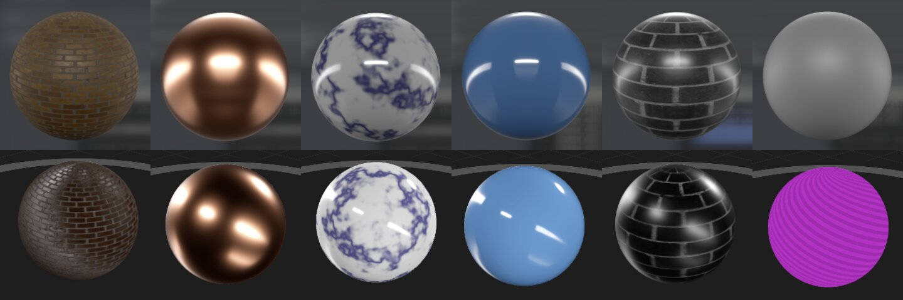
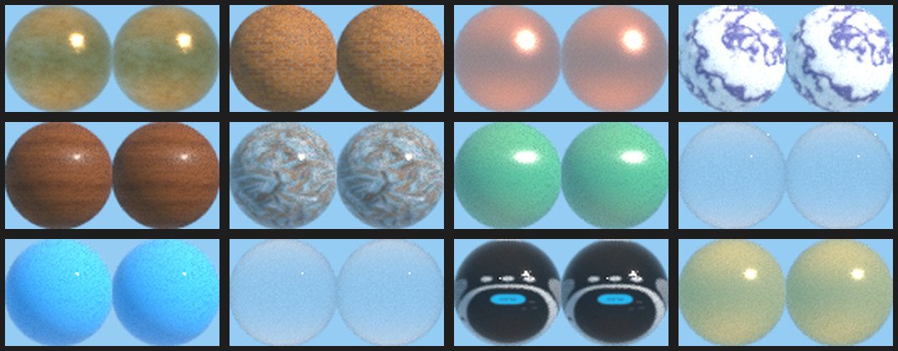

# M5: Pipeline

**Goal** (PLAN.md §8): get materials out of Margolaria and into other tools: USD and USDZ files, generated shader code (OSL first, compiled to `.oso` for Izpi, the user's path tracer), and, if it worked out, other Hydra renderers in the viewport. **Exit criterion:** USDZ opens correctly in Reality Composer Pro and Quick Look.

**Result: met.** File > Export as USDZ… writes the material the viewport shows on its sphere, the document's other materials unbound, and every texture packaged. Checked two ways:
- **By the user (2026-11-06):** six examples opened in Quick Look and Reality Composer Pro, with screenshots (below). The greyscale bricks, drawn wrong at first, were checked again after the fix.
- **By `USDZExportTests`:** every material of every example is exported. Each file passes OpenUSD's validators and contains every texture it refers to. RealityKit's `RealityRenderer` draws it from its MaterialX graph exactly when the export doesn't warn about an unsupported surface.

The glTF PBR material is grey in Quick Look and magenta in Reality Composer Pro: RealityKit doesn't know the surface, and Export as USDZ… warns about it. Glass comes out black in both, because RealityKit has no transmission.

Each PR's own exit criterion is checked by a test:

| PR | Exit criterion | Test |
|---|---|---|
| M5a | A spike report: what Quick Look and Reality Composer Pro render, which workarounds they need, whether a UsdPreviewSurface fallback is worth it | `docs/spikes/M5a-usdz.md` (RealityKit renders 38 of the 50 examples from their graphs; no fallback) |
| M5b | Every example exported and read back gives the same materials as UsdMtlx reading the `.mtlx`, with no reference to it; Storm renders the file like the document | `USDExportTests`, also on every example's nodegraphs made into definitions |
| M5c | M5's criterion (above) | `USDZExportTests`, and the hand check |
| M5d | Every material and every node with a swatch generates MSL, GLSL and both forms of OSL; the MSL compiles with Metal; every material's OSL compiles to `.oso` | `GeneratedShaderTests` (1,224 shaders, all but 12 known MSL failures), `MXShaderCodeTests`; beyond the criterion, every material's two OSL forms rendered by `testrender` and compared, and `convertsToACEScg` (values printed by `testshade`) |
| M5e | Every example renders in each listed renderer, and switching back leaves Storm's image the same; or notes on why not | `RendererPickerTests`. Embree passes, but is left out of the app (below) |

Dates: 2026-11-04 (plan) to 2026-11-07. Six PRs: #43 (the M5 plan), #44 (M5a), #45 (M5b), #46 (M5c), #47 (M5d), #48 (M5e). The app and MargolariaKit grew from about 31,900 to 35,200 lines of Swift, C++ and Objective-C++, and from 242 to 260 test functions. Two build scripts (about 310 lines) and Margolaria's first MaterialX library file (`margolaria_cmlib.mtlx`, 387 lines) are new.

## What was built

| PR | Scope | Main pieces |
|---|---|---|
| **M5a** (#44) | Spike: USDZ in Apple's viewers | `MGUSDExporter` (a stage built as the viewport's, flattened, packaged by `UsdUtils`, checked by OpenUSD's validators) · the preview sphere shared with the Storm renderer (`MGPreviewSphere`) · `Spikes/M5aUSDZ/RealityKitRender.swift`, rendering USD files offscreen with RealityKit · `docs/spikes/M5a-usdz.md` |
| **M5b** (#45) | USD export | File > Export as USD… (`.usda`, `.usdc`, chosen in the panel) · the materials under `/MaterialX`, flattened, standing alone · definitions made or included in the document expanded, then left out (`MXDocument.usdXMLString()`) · textures in or under the file's folder written relative |
| **M5c** (#46) | USDZ export | File > Export as USDZ… · the sphere bound to the viewport's material (the document's `previewMaterial`) · a warning for surfaces RealityKit doesn't render (`quickLookIssues`) · greyscale images read as colours rewritten (`usdzXMLString`) · weighted mixes spelled out (`SpellOutWeightedMixes`) |
| **M5d** (#47) | Generated shader | The bottom panel's Generated Shader tab: the selection's shader, or the viewport's material, in MSL, GLSL, OSL or OSL Network, with Copy and Export… · `scripts/build-osl.sh` (OSL 1.15.8's `oslc`, `testshade`, `testrender`) · `scripts/build-materialx-genosl.sh` (MaterialX's OSL generators as `MaterialXGenOsl.xcframework`, with the 792 library nodes compiled to `.oso` as its resources) · `Document::generateCode`, `MXShaderCode`, `MXShaderExport` · `.oso` compiled with any `oslc` chosen in the Export panel · shaders computed in the document's working space (ACEScg), with Margolaria's own transforms (`margolaria_cmlib.mtlx`) |
| **M5e** (#48) | Renderer picker | `MGStormRenderer` lists Hydra renderer plugins and switches between them (`setRendererID:error:`) · `ViewportRenderer` · a picker in the viewport's bar, shown only when more than Storm is usable · snapshots wait by time and take any frame format |

Margolaria now writes USD for pipelines, USDZ for Apple's viewers, and shader code for renderers, OSL above all.

Every material's OSL is rendered by OSL's own `testrender` in both of MaterialX's forms, under testrender's sky, and the two must match. They do for all 66 materials; hair is only compiled, as testrender has no hair closure. The twelve above are a sample.

## Decisions

The full list, with reasons, is in PLAN.md §8.6. The ones that shaped the code most:

1. **A spike first** (M5a). The exit criterion depends on what Reality Composer Pro and Quick Look accept, and only real files could tell. It settled three of the plan's questions before any export code was written. RealityKit renders MaterialX graphs itself, so no UsdPreviewSurface fallback is needed. Exports start from the viewport's text. Inputs with no value must go.
2. **USD export writes the materials alone, flattened** (M5b). A reference to the `.mtlx` would need the UsdMtlx plugin wherever the file is read; flattened prims stand alone. Binding them to the user's models is left for later.
3. **USDZ export writes a scene: one sphere, the viewport's material on it** (M5c). A USDZ with no geometry shows nothing. The other materials go in unbound, for binding in Reality Composer Pro.
4. **Fix the graph rather than warn, when the result is the same** (M5c). A greyscale image read as a colour becomes a float image, a `convert` and the file's colour transform. A mix weighted by a colour becomes `add(bg, multiply(subtract(fg, bg), mix))`. Both compute the same and render right in Apple's viewers; Storm draws both like the document. Surfaces RealityKit doesn't know get a warning, since nothing equivalent exists.
5. **Build what SwiftUsd doesn't ship** (M5d). As OCIO was in M3, MaterialX's OSL generators are compiled from MaterialX 1.39.5's sources against SwiftUsd's own MaterialX, so both share one MaterialX at run time. Homebrew has no OSL, so OSL's tools are built from source for development and tests. The app uses any `oslc` the user picks.
6. **Both OSL forms, chosen when exporting** (M5d). Izpi will compile `.oso` files. One shader per material is simplest to load; a network reuses the library's compiled nodes. Both come from the same generator sources.
7. **Shaders compute in the document's working space** (M5d, at the user's request: Izpi renders in ACEScg). MaterialX's colour library converts only to lin_rec709, so Margolaria adds transforms to ACEScg in its own library file. They are used only for generating shaders; the node library and the swatches are unchanged.
8. **Pickers go beside what they change** (M5d, M5e). The shader language picker is in the tab's bar, and the renderer picker in the viewport's bar, not in the toolbar as §4.1 had them.
9. **No renderer is offered that can't run under Metal's validation** (M5e). Embree is left out: OpenUSD stops in its depth copy in Debug runs, and it draws shape only. The switching stays, tested, for the renderers to come.

## Problems found and fixed (worth remembering)

| Where | Problem | Fix |
|---|---|---|
| M5a | RealityKit draws nothing, not even a fallback, for a material with an input declared without a value (UsdMtlx's `normal`, `tangent`); OpenUSD's validators don't notice | Such inputs are removed from the flattened layer; they take their defaults anyway |
| M5a | A definition made in the document doesn't package: UsdMtlx records the `.mtlx` as its source | Every such definition is expanded into its nodes before export |
| M5a | `qlmanage -t` hangs on USDZ files in the sandbox | Rendered offscreen with `RealityRenderer` instead |
| M5c | Reality Composer Pro reads a greyscale image used as a colour into red only | The image is read as a float and converted (`usdzXMLString`) |
| M5c | That rewrite drew cyan stripes in Quick Look and white in RCP, caught only by the screenshots: the colour transform ends in a mix weighted by a colour, which RealityKit doesn't compile; the test only checked that something was drawn | Weighted mixes are spelled out in arithmetic (`SpellOutWeightedMixes`); the test now checks the bricks come out grey and textured |
| M5d | MaterialX's OSL generators: the Ci wrapper crashes on a multi-output node; the network leaves out the values of the node it starts from; it can't do definitions made in the document (`std::bad_cast`); it writes filenames unquoted; `create()` is compiled into the caller | Each worked around in `Document::generateCode` (§8.2): no wrapper there; a `dot` (or `mix`, for closures) reading the node; definitions expanded on a copy; quoted; resources found through `TARGET` |
| M5d | LibsToOso aborts when asked not to write the OSL sources | It writes them; the build script deletes them |
| M5d | MaterialX's colour library has no transforms to ACEScg, so every shader came out in lin_rec709 | `margolaria_cmlib.mtlx`: each space to lin_rec709 by MaterialX's own transform, then the exact inverse of its ACEScg matrix; checked by `testshade` |
| M5d | testrender refuses an empty scene, needed as the background to compare against | A speck of a sphere far away |
| M5e | Embree's frames are 32-bit float; the test snapshots drew them as blue tiles | The snapshot's target takes its display pass's own format |
| M5e | Embree refines its image on its own threads; twenty quick renders weren't enough to finish | Snapshots wait by time (up to 10 s), not by a number of renders |
| M5e | With Metal's validation on (Xcode's Debug runs), OpenUSD stops in Embree's first frame: it copies the depth between texture formats, R32Float into Depth32Float (§8.2) | Not fixable from Margolaria; Embree is left out of the app |

## Not done / open

These are kept for the UX polish pass after the initial milestones:

- **Absolute texture paths in USD exports.** Textures outside the file's folder stay absolute, with no warning (M5b).
- **The oslc setting** lives in the Export Shader panel, as there is no Settings window yet (M5d).
- **The swatches** still compute in lin_rec709, while the Generated Shader tab computes in the working space (M5d).
- **MSL for 12 swatches** fails to generate, in MaterialX itself, as it did before M5 (§8.2).
- **A hand comparison in Houdini** (Solaris and Karma read USD with MaterialX natively): M5b's exports against Storm, as a second opinion. Not done; worth doing once.
- **Reports upstream.** To OpenUSD: Hydra's depth copy for CPU renderers on Metal (M5e), and UsdMtlx's inputs without values (M5a). To MaterialX: the OSL generators' five problems (M5d), and the missing transforms to ACEScg. To Apple (Feedback): Reality Composer Pro's greyscale images, and RealityKit's weighted mixes (M5c). Each has a workaround here, except the first; minimal reproductions are still to be written.
- **Left for later** (§8.6): binding materials to the user's own USD models; MDL and Slang targets; third-party Hydra renderers; baked textures; a `margolaria export` command line (M6).
- **Izpi as a Hydra renderer**, when it becomes one (PLAN.md §8.6, "Left for later"): built against SwiftUsd's exact OpenUSD, embedded in the app for releases, or loaded from a plugins folder while developing it (signed by the same team, so no entitlement), and needing a fix to the depth copy above first if it renders on the CPU.
- **Not in M5, as planned:** OpenImageIO (OpenEXR already works); Python (M6).
