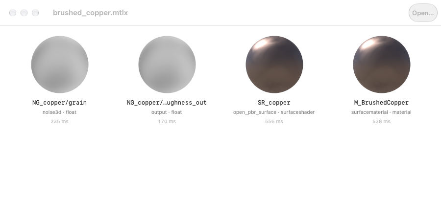

# Spike M0c: MSL generation and swatches

**Question** (PLAN.md §8, M0c): Can we generate Metal shaders for single node outputs with MaterialX's `MslShaderGenerator`, and render a swatch with our own small Metal renderer?

**Answer: yes.** `MslShaderGenerator` (shipped in SwiftUsd) generates MSL for any node, nodegraph output or material. A small Swift renderer (PreviewKit: about 700 lines, many of them comments) compiles it, binds its inputs by name through Metal's pipeline reflection, and draws it on an environment-lit sphere. A material swatch takes about 0.5 s the first time, almost all of it shader compilation, and about 6 ms after that.

Date: 2026-10-18. SwiftUsd 8.1.0 (MaterialX 1.39.5), Xcode 27.1, Swift 6.4, macOS 27.0.1 on arm64.



## What was built

```
SwatchSpike.app ──▶ PreviewKit (Swift + Metal) ──▶ MXKit ──▶ MXBridge (C++) ──▶ MaterialXGenMsl
                     SwatchRenderer                generateMSL   generateMsl
```

- **MXBridge / MXKit**:
  - `MXDocument.generateMSL(for: path, library:)` returns an `MXGeneratedShader`. It holds:
    - the vertex and fragment source;
    - the output type;
    - every uniform with its default value.
  - `MXDocument.shadeableElements` lists every top-level node and material, plus every node and output inside nodegraphs, with their paths. Element summaries gained a `path` field.
- **PreviewKit**, a new target (pure Swift + Metal, no C++ of its own):
  - **`SwatchRenderer`** compiles the MSL with `device.makeLibrary(source:)`, builds the pipeline with reflection, and fills the uniform buffers member by member. It draws a sphere with 4× MSAA and returns a texture or a `CGImage`.
  - **`SwatchGeometry`** is a UV sphere with position, normal, tangent, bitangent and texcoord. The vertex layout is built from the attributes the generated vertex function declares.
  - **`SwatchEnvironment`** turns `StinsonBeach.hdr` (from SwiftUsd, the same image the Storm viewport uses) into two textures: a mipmapped radiance map and a small blurred irradiance map.
- **Tests:**
  - `MXKitTests/MXShaderTests` cover generation, the element list and unknown paths.
  - `PreviewKitTests` cover:
    - the noise node, the copper material, a green plastic and a checkerboard (which proves texture coordinates arrive);
    - timing.
  - They write PNGs, and the MXKit tests also write the generated `.metal` files, to `VIEWPORT_SNAPSHOT_DIR`.
- **`Spikes/M0cSwatches`**: the `SwatchSpike` app. It shows a grid with one swatch per shadeable element of a file, and each swatch's time.

## How generated MSL expects to be fed

What MaterialX 1.39.5's MSL looks like, and what `SwatchRenderer` does about it:

| Input | In the generated source | What we do |
|---|---|---|
| Vertex attributes | `struct VertexInputs` with `i_position [[attribute(0)]]`, then `i_normal`, `i_tangent`, `i_texcoord_0`, … as the graph needs | Read `vertexFunction.vertexAttributes`, map each name to an offset in our vertex. Geometry goes in buffer slot 30, clear of the uniform buffers. |
| Node inputs | `struct PublicUniforms` (`u_pub`), one member per input. Members are named after the input (`amplitude`), or prefixed with the node name (`SR_copper_base_color`) in bigger graphs. | Defaults come from `MXGeneratedShader.uniforms`; we write each at the member offset Metal reports. |
| Renderer values | `struct PrivateUniforms` (`u_prv`): `u_worldMatrix`, `u_viewProjectionMatrix`, `u_envMatrix`, `u_viewPosition`, `u_envRadianceMips`, … | A fixed table of names in `uniformValues(for:)`. |
| Lights | `LightData_pixel` (`u_lightData`), an array of `MAX_LIGHT_SOURCES` | Left zeroed, with `u_numActiveLightSources = 0`: environment lighting only. |
| Environment | `u_envRadiance_tex`/`_sampler`, `u_envIrradiance_tex`/`_sampler` | Our two textures, plus a linear, mipmapped sampler. |
| Buffer indices | **Different for every shader.** For example, `u_pub` is buffer 0 for the noise node and buffer 2 for the copper material. | Taken from reflection (`.bindingInfo` and `.bufferTypeInfo`), never hard-coded. |
| Orientation | The vertex stage ends with `pos.y = -pos.y` | The projection is pre-flipped, so swatches come out upright. |

## Timing

Copper material, 256 × 256, 4× MSAA:

| Step | Time |
|---|---|
| `generateMSL` (MaterialX) | 9 ms |
| First render: compile ~3,600 lines of MSL, build the pipeline, draw | **480 ms** |
| Same shader again (macOS's shader cache, keyed by source) | 6 ms |
| In the app, first launch, per element | 170–560 ms |

**What this means for M3**, whose goal is updating swatches within 100 ms of an edit:
- **Value edits are cheap.** Input values live in uniform buffers, not in the source. Changing a value only means rewriting a buffer, provided we cache pipelines by a hash of the source, as PLAN.md §5 already says.
- **Graph edits are not.** Connecting or adding nodes changes the source and costs roughly half a second of compilation. Compilation must run off the main thread, keeping the old swatch until the new pipeline is ready.

## Gotchas found (worth remembering)

1. **The macOS shader cache hides compile times.** Metal caches compiled shaders by source text across processes, so a repeated benchmark looks free. The timing test renames the shader node to a random name, which changes the source and forces a cold compile.
2. **Swift 6 rejects `static let` for non-`Sendable` classes.** That covers Metal descriptors and our own renderer: a static is a global any thread can reach. Create them per instance instead (the depth state in `SwatchRenderer.init`, the renderer per test).
3. **Shader generation needs the libraries' folder.** `GenContext.registerSourceCodeSearchPath` must point at the folder containing `libraries/`, because per-node MSL snippets are read from `libraries/stdlib/genmsl/…`. The bridge's `Library` now remembers that folder.
4. **MaterialX matrices are row-major and Metal's are column-major.** `matrix44` defaults are transposed before being written. Our own camera matrices are built column-major.
5. **`float3` in a struct takes 16 bytes.** The offsets from reflection already account for it; only `float3x3` needs explicit per-column padding.
6. **Core Image and Metal disagree about "up".** Images are flipped (`.downMirrored`) when loaded into the environment texture and when read back.

## Not done / open

- **File textures.** `image` and `tiledimage` nodes get a 1×1 grey placeholder. Loading textures, with colour spaces, comes with image I/O (PLAN.md §3).
- **Direct lights.** Swatches use the environment only; `u_lightData` is zero.
- **Irradiance** is a blurred thumbnail of the HDR, not a cosine convolution. That's fine for swatches; use MaterialX's prefiltered maps, or compute proper ones, in M3.
- **Pipeline cache and background compilation**, as above, for M3.
- **Vertex colours and other geometric properties.** Shaders that ask for an attribute the sphere doesn't have fail with `PreviewError.unsupported`.
- **Swatch shapes.** Everything renders on a sphere. A plane may suit 2D patterns better; that's a design decision for M3.
- **Colour.** Output is linear Rec.709 converted to sRGB. OCIO view transforms come in M3.
