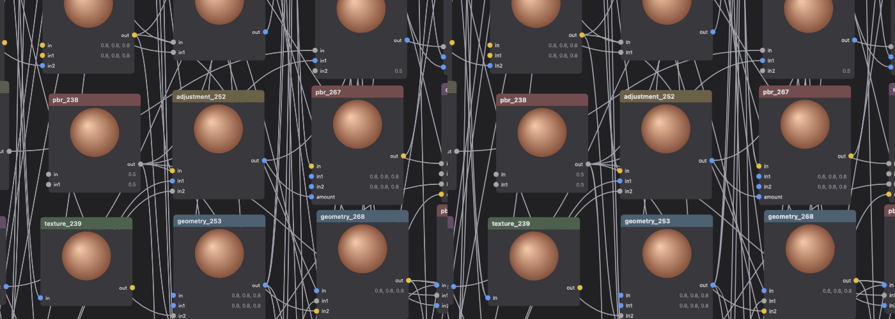

# Spike M0d: graph canvas

**Question** (PLAN.md §8, M0d; open question 2 in §9): Should the graph canvas use SwiftUI `Canvas`, AppKit with Core Animation, or Metal? The target is about 500 nodes at 120 fps, with hit testing, marquee selection and wires.

**Answer: Core Animation (an `NSView` with one layer per node). Metal is not needed.** Both SwiftUI `Canvas` and Core Animation keep up with 2,000 nodes on a 144 Hz display, four times the target. Core Animation was the steadier of the two:
- Panning and dragging nodes never missed a frame.
- While zooming, 95% of its frames arrived on time, against about 86% for `Canvas`.

Its cost also grows with what *changes*, not with what is *visible*. That matters once nodes show live swatches and the window is on a Retina screen.

Date: 2026-10-18. Xcode 27.1, Swift 6.4, macOS 27.0.1, Apple M2 Max.



## What was built

```
GraphSpike.app ──▶ GraphKit
                    GraphModel            nodes, pins, wires; a repeatable synthetic graph
                    GraphLayout           geometry (node frames, pin positions, wire curves), colours
                    GraphCanvasController camera, selection, hit testing, mouse handling (@Observable)
                    ├─ CanvasGraphView    renderer 1: SwiftUI Canvas, redraws what is visible every frame
                    └─ LayerGraphView     renderer 2: Core Animation, one cached image per node
                    GraphBenchmark        scripted camera and drag motions, timed with a display link
```

- **GraphKit**, a new pure-Swift target. Both renderers share everything except drawing:
  - the model;
  - the layout maths;
  - the controller: hit testing, click and Shift-click selection, marquee, dragging, scrolling, zoom anchored at the pointer;
  - `GraphEventView`, which passes AppKit mouse, scroll and pinch events to the controller.
- **The synthetic graph** (`GraphModel.synthetic`) puts nodes in columns. Each node has between one and eight inputs, and about 70% of them are wired to nodes in earlier columns, so the graph has no cycles. At 500 nodes that gives 926 wires; at 2,000 nodes, 3,578. Every node has a 96-point thumbnail, standing in for a PreviewKit swatch.
- **Level of detail**, the same in both renderers:
  - node titles appear from zoom 0.4;
  - port labels and values from zoom 0.6.
- **Tests** (`GraphKitTests`) cover:
  - the synthetic graph;
  - hit testing of pins, bodies and empty space;
  - selection, dragging, the marquee and the zoom anchor;
  - hit-testing speed.
- **`Spikes/M0dGraphCanvas`** contains:
  - the `GraphSpike` app, which can switch renderer and node count and has a Benchmark button;
  - `run-benchmarks.sh`, which runs every combination from the command line.

## Results

Measured in a Release build on a 1600 × 1000 pt window, on the LG display: 144 Hz (a frame every 6.94 ms), scale 1.0. Each scenario runs for 4 s after 20 warm-up frames. "Slow" is the share of frames that arrived more than 1.5 refresh intervals after the previous one, i.e. that missed at least one refresh.

The scenarios:
- **Pan overview:** the whole graph is framed and the camera circles. Every node is visible and no text is drawn.
- **Pan detail:** zoom 0.8 with all text drawn, and the camera circles.
- **Zoom:** from 0.15 to 1.2 and back every 3 s, crossing every detail level.
- **Drag 50 nodes:** zoom 0.5, with 50 selected nodes moved in a circle. The wires follow them.

| Scenario | Canvas, 500 | Core Animation, 500 | Canvas, 2,000 | Core Animation, 2,000 |
|---|---|---|---|---|
| Pan overview | 144 fps, 0% slow | 144 fps, 0% slow | 143.5 fps, 0.3% slow | 144 fps, 0% slow |
| Pan detail | 142 fps, 1.2% slow | 144 fps, 0% slow | 142.5 fps, 1.1% slow | 144 fps, 0% slow |
| Zoom | 132.5 fps, 7.2% slow, p95 14.4 ms | 129 fps, 3.5% slow, p95 7.0 ms | 132.5 fps, 8.3% slow, p95 13.9 ms | 129 fps, 3.5% slow, p95 7.0 ms |
| Drag 50 nodes | 144 fps, 0% slow | 144 fps, 0% slow | 144 fps, 0% slow | 144 fps, 0% slow |
| Worst frame | 22 ms | 43 ms | 19 ms | 44 ms |

The raw output of `run-benchmarks.sh` is in `build/benchmarks/` after a run.

**Reading the numbers:**
- **`Canvas`** redraws every visible node, wire and label on every frame. It is fast enough: a slow frame costs one extra refresh (about 14 ms), never more. But its zoom and detail pans miss a refresh now and then, already at 500 nodes.
- **Core Animation** only changes one transform while panning, so the window server composites the cached node images and the app does almost nothing per frame. Its slow frames come from crossing a zoom step, when the visible nodes are redrawn at the new resolution. Those frames are rarer but longer, up to about 44 ms.
- **The first version of the Core Animation renderer redrew every node at each zoom step,** including those off-screen. At 2,000 nodes that one frame took **622 ms**, and the zoom scenario averaged 63 fps. Redrawing only the nodes on or near the screen, and the rest when they scroll into view, fixed it (`LayerGraphView.update()`).

## Decision

**Core Animation**, for these reasons:
1. **Its cost follows changes, not content.** A static or panning canvas costs almost nothing, however many nodes and labels are visible. `Canvas` pays for every visible element on every frame.
2. **Real swatches will make each node more expensive to draw.** In the spike every node shows the same image. In the app each node has its own swatch, updated as the user edits. With layers, a new swatch only replaces that one layer's `contents`. With `Canvas`, every frame draws every visible swatch again.
3. **Retina has four times the pixels.** These measurements are at scale 1.0. On a Retina display (scale 2) `Canvas` rasterises four times as many pixels per frame, whereas cached layer images are only redrawn at zoom steps.
4. **AppKit gives us the event handling we need anyway**: right-click menus, drag and drop from the Library, key handling, cursor rectangles. The `NSView` already exists for both renderers; `Canvas` sat in front of it in this spike.
5. **Metal is not needed.** Core Animation already uses the GPU for compositing, and neither renderer came close to failing the target.

What we give up: `Canvas` code is shorter (166 lines against 384) and has no cache to invalidate. The cost of the layers is bookkeeping: redraw when the zoom step, the node's content or the backing scale changes, and when nodes come into view. `LayerGraphView` is a model of that.

## Gotchas found (worth remembering)

1. **macOS stops display links while the screen is locked or asleep, or the window is hidden.** The first benchmark run waited forever. `GraphBenchmark` now has a watchdog that stops with a message after 5 s without frames. `run-benchmarks.sh` uses `caffeinate -d` to keep the display awake.
2. **`CGColor(red:green:blue:alpha:)` is not sRGB.** It uses a generic RGB space, so the same numbers looked lighter than SwiftUI's `Color(red:green:blue:)`. Use `CGColor(srgbRed:green:blue:alpha:)`.
3. **`CTFont` isn't `Sendable`**, so Swift 6 rejects `static let font: CTFont`. CoreText documents fonts as immutable and thread-safe, so `nonisolated(unsafe)` with a comment is justified here (`NodeLayer.titleFont`).
4. **`withObservationTracking` fires once, and *before* the change.** The layer renderer re-registers every time and schedules its update on the main actor, so that it reads the new values (`LayerGraphView.observeController()`).
5. **Layer property changes animate by default.** Every update runs in a `CATransaction` with actions disabled. Node layers also disable the `contents` cross-fade.
6. **Layers wider than the node.** Pins stick out of the node's frame by their radius, so each node layer is wider than the node by that margin. A layer is clipped to its bounds when it is drawn.
7. **A benchmark built on a display link only measures the app's side.** It can't see frames the window server drops after the app commits them. For that, use Instruments' *Animation Hitches* template. The numbers above are a quick, repeatable comparison, not a hitch audit.
8. **Resizing a view changes what is visible without changing the controller.** The layer renderer also updates when its size changes, or nodes uncovered by a resize would stay blank. (In the spike this was in `layout()`; M1b moved it to `setFrameSize(_:)`, which AppKit calls on every size change, while `layout()` only runs when a view is marked as needing layout.)

## Not done / open

- **Spatial index.** Hit testing walks every node: 1,000 hit tests on a 5,000-node graph take about 0.6 s in a debug build, so 0.6 ms each, at most one per mouse event. Add a grid or R-tree only if real graphs need it.
- **Wires are one `CAShapeLayer` holding every curve,** rebuilt when any node moves. That is fine at 3,578 wires. If dragging in larger graphs slows down, split the wires into the moving ones and the rest.
- **Wire routing, pin dragging, the node library, keyboard handling and accessibility** come in M2. The spike only has straight cubic curves and selection.
- **Retina measurements.** Both renderers were measured at scale 1.0 only. Repeat the benchmark with the window on the built-in display (120 Hz, scale 2) when convenient.
- **Hitch audit** with Instruments (gotcha 7) once the real canvas exists.
- **Memory.** Every node layer keeps an image at the last detail level it was drawn at. At the highest step (zoom above 2) a typical node's image is about 2.5 MB at backing scale 1, and about 10 MB on Retina. Panning across a large graph at high zoom leaves many of them behind. Drop the images of nodes far off-screen, or cap the scale, if memory grows.
