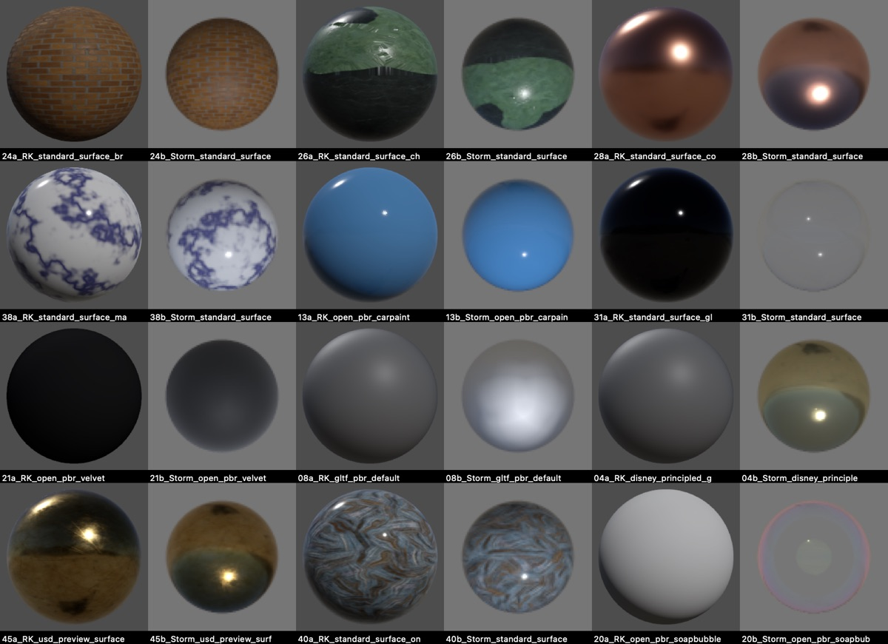

# Spike M5a: USDZ in Apple's viewers

**Question** (PLAN.md §8.6, M5a): what do Quick Look and Reality Composer Pro render from MaterialX exported as USDZ, which of the viewport's Storm workarounds do they need too, and is a UsdPreviewSurface fallback worth it?

**Answer: most of it renders, after one fix.** RealityKit, the engine behind Quick Look and Reality Composer Pro, reads MaterialX graphs in USD as shader graphs. That includes `standard_surface`, `open_pbr_surface`, `UsdPreviewSurface`, textures and procedural patterns. It needed one change to UsdMtlx's output: inputs declared with no value, which RealityKit rejects. After it, 38 of MaterialX's 50 examples render through their MaterialX graph, most like Storm. The other 12 don't: Disney principled, glTF PBR and hair, which RealityKit doesn't know, and fall back to a plain grey material (the hair example also fails to export). Transmission (glass, honey, soap bubble) and sheen (velvet) don't match. Exports must start from the viewport's text, not the plain preview text. Two of the shapes M4's edits make broke otherwise, and so would every definition made in a document.

Date: 2026-11-04. SwiftUsd 8.1.0 (OpenUSD v26.08, MaterialX 1.39.5), macOS 27.0.1 on arm64.

**Checked by eye** (2026-11-04, by the user): the seven files listed at the end, in Quick Look and in Reality Composer Pro. Quick Look matches the offscreen RealityKit renders on all seven. Reality Composer Pro matches on five, and differs on two (finding 7).

## What was built

- **`MGUSDExporter`** (ViewportBridge, Objective-C++, beside the Storm renderer). It builds a stage the way the viewport does:
  - the document's text written to a file and referenced through UsdMtlx;
  - a preview sphere bound to the first material;
  - the stage flattened into one layer, with valueless inputs removed (below);
  - written as `.usda`/`.usdc`, or packaged as `.usdz` by `UsdUtilsCreateNewUsdzPackage` or `UsdUtilsCreateNewARKitUsdzPackage`.

  It also runs OpenUSD's validators (`UsdValidationContext` with every registered validator) and lists a file's asset paths. The preview sphere moved from MGStormRenderer.mm into `MGPreviewSphere.h/.mm`, shared by both.
- **`USDZSpikeTests`** (ViewportKitTests, only with `M5A_EXPORT_DIR` set; replaced in M5c by `USDZExportTests`, which keeps its files with `M5C_EXPORT_DIR`):
  - **"Every example exports":** each example, from the preview text and from the viewport's text, as `.usda`, `.usdz` and ARKit `.usdz`, with a report of asset paths and validator messages.
  - **"M4's shapes export":** three documents built through M4's calls (below).
- **`Spikes/M5aUSDZ/RealityKitRender.swift`**, a standalone script. It renders USD files with RealityKit's `RealityRenderer`, offscreen, lit by Storm's default environment, and prints which material type RealityKit made of each.

## Findings

1. **Packaging works.** `UsdUtilsCreateNewUsdzPackage` copies every texture into the package and rewrites its absolute path as a relative one (`0/brick_normal.jpg`). Nothing else is needed for textures. The ARKit variant flattens and checks as well, and gave the same files here.
2. **Inputs without a value break RealityKit.** UsdMtlx declares every nodedef input whose default is a geometric property (`normal`, `tangent`, `coat_normal`: "the geometry's own"), with no value. Storm reads that as the default. RealityKit logs "Value type for input is not valid" and draws nothing at all: not a fallback, an empty space. Removing those inputs from the flattened layer fixes it, and they take their defaults anyway (`RemoveInputsWithoutValues`). OpenUSD's validators don't flag them, so only RealityKit itself can check this.
3. **What RealityKit renders** (50 examples, the viewport's text, ARKit packaging):

   | Surface | Examples | RealityKit |
   |---|---|---|
   | `standard_surface` | 22 | Shader graph. Opaque ones look like Storm: textures (brick, wood, chess set), procedurals (marble, onyx hex tiles), metals, car paint, jade, velvet. Glass, tinted glass and thin film come out as black mirrors: no transmission |
   | `open_pbr_surface` | 10 | Shader graph. Car paint, ketchup, pearl, aluminium and the light bulb's emission look right. Glass, honey and soap bubble come out opaque white (no transmission); velvet black (no sheen) |
   | `UsdPreviewSurface` | 6 | Shader graph, like Storm, except glass (black, as above) |
   | `disney_principled` | 5 | **Not supported:** a plain grey `PhysicallyBasedMaterial` |
   | `gltf_pbr` | 6 | **Not supported:** the same grey fallback |
   | `simple_hair` (a nodedef in the document) | 1 | Doesn't export: UsdMtlx records the document's `.mtlx` as its source, and packaging can't write that file back (below) |

   

   The environment's orientation differs between the two renderers: RealityKit shows the beach below the horizon, Storm above. Compare the materials, not the reflections. The two look examples aren't compared: their Storm image is another of their materials.
4. **The viewport's text is needed, but not for the examples.** None of the 50 examples has the shapes the Storm workarounds change, so their preview text and viewport text export to identical files. Documents built through M4's calls do have them:

   | Shape | Preview text | Viewport text |
   |---|---|---|
   | A nodegraph read by a multiply (not a shader) | Black: the same UsdMtlx problem Storm has (§8.2) | Right |
   | An image's file promoted to the graph's input, tagged sRGB | Right | Right |
   | A definition made in the document, read by the material | Doesn't package (as simple_hair); exported as `.usda`, RealityKit falls back to grey | Right: the node is expanded |

   So exports start from the viewport's text, as the plan assumed. `simple_hair` shows that definitions without images need expanding too. Today the viewport's text only expands definitions whose implementation reads a file, because that is all Storm needs.
5. **OpenUSD's validators** find nothing wrong in 49 of the 50 exports. In `simple_hair` they report the shader's unknown nodedef and the unresolvable `.mtlx`. They don't catch finding 2.
6. **Quick Look thumbnails from the command line** (`qlmanage -t`) hang on USDZ files in the spike's sandbox, but work for images. Running them outside the sandbox needs your approval, and `RealityRenderer` gave what was needed instead.
7. **Quick Look and Reality Composer Pro mostly agree, with two differences.**
   - **An unsupported surface:** `gltf_pbr_default` shows Reality Composer Pro's magenta "missing material" pattern, where Quick Look falls back to plain grey. Same cause, louder signal.
   - **A greyscale image read as a colour:** `m4_definition`'s bricks come out red in Reality Composer Pro, grey in Quick Look. Its texture, `brick_base_gray.jpg`, is a single-channel JPEG read by an `image_color3`. Quick Look (RealityKit at run time) copies the grey into all three channels; Reality Composer Pro puts it in red only. 27 of the examples' textures are single-channel, but the examples read them as floats (`image_float`), so none of them shows it.

## Decisions for the plan (§8.6)

1. **Export from the viewport's text, with every definition made in the document expanded** (not only those with images), and inputs without values removed.
2. **No UsdPreviewSurface fallback in M5.** RealityKit renders MaterialX graphs directly, including `UsdPreviewSurface` itself. Its gaps are surfaces it doesn't know (Disney principled, glTF PBR, hair), transmission and sheen, and a UsdPreviewSurface fallback wouldn't help those. Instead, Export as USDZ… warns when a material uses a surface RealityKit doesn't render. `UsdBakeMtlx` wasn't tried: it would only matter for viewers without MaterialX support, which aren't M5's target.
3. **One sphere, bound to the material the viewport shows; the document's other materials included, unbound.** Nothing in the spike argues for more. Reality Composer Pro lists every material in the file, so they can be bound there.
4. **Greyscale images read as colours** (finding 7): in M5c, either have export read them as a float and convert to colour (`image_float` then `convert`, which computes the same), or warn. To decide in M5c: rewriting is invisible and reliable, but it changes the graph more than the other workarounds do.
5. **M5c's exit check can be automated.** `RealityRenderer` runs in a test without a window: each exported example loads as a shader graph (or is one of the known unsupported surfaces) and draws something other than the background. Checking Quick Look and Reality Composer Pro by hand stays, for a few examples, with screenshots in the milestone write-up.

## Checked by hand

Opened in Quick Look (select in Finder, press Space) and in Reality Composer Pro. They are in the scratchpad's `m5a` folder, or could be made again with `M5A_EXPORT_DIR=<folder> swift test --filter USDZSpikeTests` in `Packages/MargolariaKit` until M5c (now `M5C_EXPORT_DIR=<folder> swift test --filter USDZExportTests`, through the final export). Each looked like its RealityKit render above, except in Reality Composer Pro as finding 7 says:

- `standard_surface_brick_procedural.viewport.arkit.usdz` (textures, procedural mask);
- `standard_surface_copper.viewport.arkit.usdz` (metal, environment);
- `standard_surface_marble_solid.viewport.arkit.usdz` (3D procedural);
- `open_pbr_carpaint.viewport.arkit.usdz` (coat);
- `standard_surface_glass.viewport.arkit.usdz` (expected wrong: black, no transmission);
- `gltf_pbr_default.viewport.arkit.usdz` (expected grey fallback);
- `m4_definition.viewport.arkit.usdz` (a definition, expanded).
